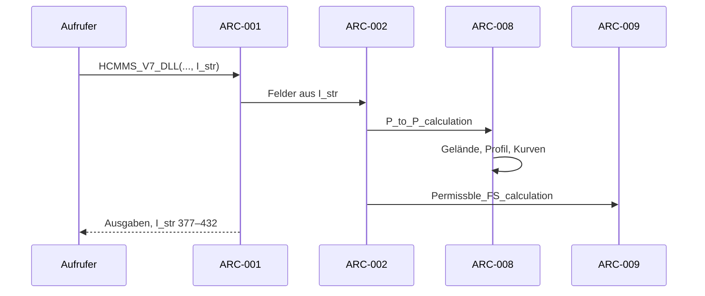

# Architektur — HCMMS C++

**Version:** 0.1.0. **Status:** Draft. **Autor:** Michael Rohner, **Datum:** 2026-11-05.

Komponenten- und Sequenzsicht zu [Lastenheft](lastenheft.md) und
[Spezifikation](spezifikation.md).

---

## 1. Komponenten-Übersicht

| Kennung | Komponente | Pfad | Fortran-Vorbild |
|---|---|---|---|
| ARC-001 | Schnittstelle (C-Funktion, String-Layout) | `src/hcm_ms.cpp` | `HCMMS_V7_DLL` |
| ARC-002 | Ablaufsteuerung, Eingabeprüfung | `src/hcm_ms.cpp` | `HCM_MS_V7` |
| ARC-003 | Fortran-Ein-/Ausgabe-Regeln | `src/fortran_io.cpp` | Laufzeit (`READ`, `WRITE`) |
| ARC-004 | Geometrie | `src/geo.cpp` | `Calc_distance`, `Calc_direction`, `CooConv`, `New_coordinates` |
| ARC-005 | Gelände und Profil | `src/terrain.cpp` | `Point_info`, `PROFILE` |
| ARC-006 | Antennen | `src/antenna.cpp` | `Antenna`, `Antenna_correction`, `Ctransf` |
| ARC-007 | Feldstärke-Kurven | `src/figures.cpp`, `src/figure_tables.cpp` | `Get_FS_from_figures`, `Get_figure_FS_value` |
| ARC-008 | Punkt-zu-Punkt | `src/p2p.cpp` | `P_to_P_calculation`, `Dh_*`, `TCA_correction_calculation` |
| ARC-009 | Zulässige Feldstärke | `src/permissible.cpp` | `Permissble_FS_calculation` |
| ARC-010 | Mobile Stationen | `src/mobile.cpp` | `Position_of_mobile` und Hilfsroutinen |
| ARC-011 | Linienberechnung | `src/line.cpp` | `Line_calculation` und Hilfsroutinen |
| ARC-012 | Zustand | `include/hcmms/state.hpp` | COMMON-Blöcke, statische Locals |
| ARC-013 | Kommandozeile und Fall-Datei | `app/main.cpp`, `src/cases.cpp` | Vergleichswerkzeug der Referenz |

## 2. Schichten und Constraints

Flache Bibliothek `hcmms` (statisch) plus Programm `hcmms`. Jede Rechen-
komponente bekommt den Zustand (ARC-012) als Referenz; es gibt keine globalen
Variablen außer der prozessweiten Instanz in ARC-001. Dateizugriffe liegen nur
in ARC-005, ARC-010 und ARC-011.

## 3. Externe Abhängigkeiten

Nur die C++17-Standardbibliothek. Testdaten erzeugt das Programm
`hcmms_fixtures` (`tests/fixtures.cpp`).

## 4. Sequenz-Diagramme

### Use-Case: Punkt-zu-Punkt-Berechnung

## 5. Fehlermodelle und Resilienz

Fehler werden wie im Original als Code im Zustand gesetzt; die Ablaufsteuerung
bricht an denselben Stellen ab wie das Original. Profil-Felder wachsen bei
kleinen Punktabständen über die Größe des Originals hinaus, statt fremden
Speicher zu überschreiben.
